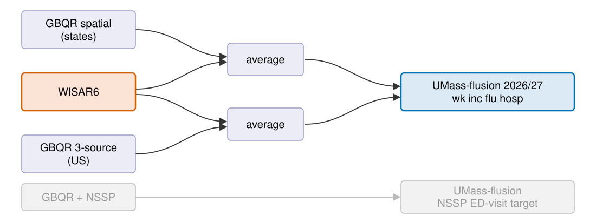

```{r}
#| label: setup
suppressPackageStartupMessages({
  library(data.table)
  library(ggplot2)
})

model_info <- data.table(
  mkey  = c("wisar", "flusion_new", "flusion_old", "gbqr", "ar6p", "ar6fp"),
  label = c("WISAR6", "flusion (new)", "flusion (prev.)", "GBQR",
            "AR6_pooled", "AR6_fourierP_thetaP"),
  color = c("#D55E00", "#0072B2", "#56B4E9", "#E69F00", "#009E73", "#CC79A7")
)
model_colors <- setNames(model_info$color, model_info$label)

read_fc <- function(season) {
  d <- fread(sprintf("data/forecasts_%s.csv", season),
             colClasses = list(character = "location"))
  d[, `:=`(reference_date = as.IDate(reference_date),
           target_end_date = as.IDate(target_end_date))]
  d[model_info, label := i.label, on = c(model = "mkey")]
  d
}
truth <- fread("data/truth.csv", colClasses = list(character = "location"))
truth[, date := as.IDate(date)]
# NHSN data as reported on each reference date (what the models trained on): slides/prep_asof.py
asof <- fread("data/asof.csv", colClasses = list(character = "location"))
asof[, `:=`(reference_date = as.IDate(reference_date), date = as.IDate(date))]

theme_deck <- theme_minimal(base_size = 17) +
  theme(panel.grid.minor = element_blank(),
        panel.grid.major = element_line(color = "#e6e6e3", linewidth = 0.4),
        legend.position = "bottom",
        strip.text = element_text(face = "bold", size = 16),
        plot.title.position = "plot")

# Small-multiple fan charts: one panel per model, shared y-axis.
plot_fc <- function(fc, loc, ref, labels, weeks_back = 10, weeks_fwd = 6,
                    loc_name = loc) {
  ref <- as.IDate(ref)
  f <- fc[location == loc & reference_date == ref & label %in% labels]
  f[, label := factor(label, levels = labels)]
  tr <- truth[location == loc & date >= ref - 7 * weeks_back & date <= ref + 7 * weeks_fwd]
  tr[, seen := date < ref]  # h=0 targets the reference week itself, which isn't observed yet
  ao <- asof[location == loc & reference_date == ref & date >= ref - 7 * weeks_back]
  ymax <- max(tr$value, f$q75) * 1.15
  ggplot(f, aes(target_end_date)) +
    geom_ribbon(aes(ymin = q05, ymax = q95, fill = label), alpha = 0.18) +
    geom_ribbon(aes(ymin = q25, ymax = q75, fill = label), alpha = 0.35) +
    geom_line(aes(y = q50, color = label), linewidth = 0.9) +
    geom_point(aes(y = q50, color = label), size = 2.2) +
    geom_line(data = tr, aes(date, value), color = "#555", linewidth = 0.4, inherit.aes = FALSE) +
    geom_point(data = tr, aes(date, value, alpha = seen), color = "#222", size = 1.8,
               inherit.aes = FALSE) +
    geom_point(data = ao, aes(date, value), shape = 21, fill = NA, color = "#222", size = 3.4,
               stroke = 0.9, inherit.aes = FALSE) +
    geom_vline(xintercept = ref - 3.5, linetype = "dashed", color = "#888") +
    scale_alpha_manual(values = c(`TRUE` = 1, `FALSE` = 0.35), guide = "none") +
    scale_fill_manual(values = model_colors, guide = "none") +
    scale_color_manual(values = model_colors, guide = "none") +
    scale_y_continuous(labels = scales::comma) +
    coord_cartesian(ylim = c(0, ymax)) +
    facet_wrap(~label, nrow = 1) +
    labs(x = NULL, y = "Weekly flu admissions",
         title = sprintf("%s · reference date %s", loc_name, format(ref, "%b %d, %Y")),
         caption = "Dots: final reported values. Rings: data as reported on the reference date (what the models saw).") +
    theme_deck + theme(plot.caption = element_text(size = 12, color = "#666"))
}
```

# Where WISAR6 lives

## The one-sentence pitch

Most Bayesian models are fit by maximizing a **likelihood**.

[WISAR6]{.wisar} is fit by minimizing **the forecast score we're graded on**.

<br>

1. Context: FluSight and UMass-flusion
2. The idea: Bayesian updating with a scoring rule instead of a likelihood
3. The model: priors, software, sampler
4. Forecasts: how it compares with other UMass models

::: notes
Two-minute opener. Plant the one idea: the loss function we fit with is the same loss we're judged by.
:::

## What we forecast

:::: {.columns}
::: {.column width="34%"}
- **FluSight:** weekly flu hospital admissions (NHSN) [@nhsn_hrd]
- 53 locations (US, 50 states, DC, PR)
- 0–3 weeks ahead
- A forecast is a **distribution**, reported as 23 quantiles
:::
::: {.column width="66%"}
```{r}
#| label: ma-peak
#| fig-width: 10
#| fig-height: 4.9
fc2324 <- read_fc("2023-24")
fc2425 <- read_fc("2024-25")
fc2526 <- read_fc("2025-26")
plot_fc(fc2425, "25", "2025-01-11",
        c("GBQR", "WISAR6", "flusion (new)"), loc_name = "Massachusetts")
```

[Bands: 50% and 90% intervals; line: median. Black points were observed when the forecast was made; grey points came later (h = 0 is the not-yet-reported current week). Dashed line: data cutoff.]{.tiny}

[Quantile levels: 0.01, 0.025, 0.05, 0.10, 0.15, …, 0.90, 0.95, 0.975, 0.99 (every 0.05 from 0.05 to 0.95, plus the four tail levels)]{.tiny}
:::
::::

::: notes
MA, reference date Feb 1 2025 (2024-25 season); MA peaked Feb 8 2025 (1,706). h=0 targets the week ending on the reference date, which hasn't been reported yet. Three panels: the two pieces that make up the MA flusion forecast, and flusion itself (their average). For states, the GBQR piece is the spatial GBQR.
:::

## UMass-flusion is an ensemble

:::: {.columns}
::: {.column width="55%"}
- **Ensemble** = average several models' forecasts, quantile by quantile
- Different model families make different mistakes, so averaging tends to cancel some of them
- UMass-flusion [@ray2024flusion] pairs:
  - **GBQR**: gradient-boosted quantile regression on several surveillance sources (machine learning)
  - an **AR model**: a statistical time-series model of the hospitalization curve
:::
::: {.column width="45%"}
**2024/25 recipe:** equal-weight average of

- GBQR (NHSN + FluSurv-NET + ILINet)
- AR(6), pooled across locations

<br>

::: {.takeaway}
The AR slot is where WISAR6 comes in.
:::
:::
::::

## How forecasts are graded: WIS {.nostretch .wis-slide}

```{r}
#| label: wis-picture
#| fig-width: 12.5
#| fig-height: 2.7
#| out-width: 100%
alphas <- c(0.02, 0.05, seq(0.1, 0.9, 0.1)); K <- length(alphas)
# WIS of a Normal(0, sd) forecast at the hub's 23 quantiles, split into width vs. miss
wis_parts <- function(y, sd) {
  lo <- qnorm(alphas / 2, sd = sd); hi <- qnorm(1 - alphas / 2, sd = sd)
  width <- sum(alphas / 2 * (hi - lo)) / (K + 0.5)
  miss  <- (0.5 * abs(y) + sum(pmax(lo - y, 0) + pmax(y - hi, 0))) / (K + 0.5)
  c(width = width, miss = miss, wis = width + miss)
}
cases <- data.table(
  case = c("Sharp, hits", "Wide, hits", "Sharp, just misses 90%", "Sharp, far miss"),
  sd = c(1, 2, 1, 1), y = c(0.3, 0.3, 2.0, 3.6))
cases[, c("width", "miss", "wis") := as.list(wis_parts(y, sd)), by = case]
cases[, panel := sprintf("%s\nWIS = %.2f\n(width %.2f + miss %.2f)", case, wis, width, miss)]
cases[, panel := factor(panel, levels = panel)]
lv <- c(0.5, 0.8, 0.9)
iv <- cases[, .(level = factor(paste0(lv * 100, "%"), levels = c("90%", "80%", "50%")),
                lo = qnorm((1 - lv) / 2, sd = sd), hi = qnorm(1 - (1 - lv) / 2, sd = sd)),
            by = panel]
ggplot() +
  geom_segment(data = iv, aes(x = lo, xend = hi, y = level, yend = level),
               linewidth = 6, color = "#D55E00", alpha = 0.45, lineend = "round") +
  geom_point(data = iv[level == "50%"], aes(x = 0, y = level), shape = 124, size = 9) +
  geom_vline(data = cases, aes(xintercept = y), linewidth = 1.6, color = "#0072B2") +
  facet_wrap(~panel, nrow = 1) +
  scale_x_continuous(limits = c(-3.6, 4)) +
  labs(x = "outcome (blue line = what happened)", y = NULL) +
  theme_deck + theme(axis.text.x = element_blank(), strip.text = element_text(size = 14))
```

$$
\text{WIS} = \frac{1}{K+\tfrac12}\Big(\tfrac12\,|y-m| \;+\; \sum_{k=1}^{K}\tfrac{\alpha_k}{2}\,\Big[\underbrace{(u_k-l_k)}_{\text{width}} \;+\; \underbrace{\tfrac{2}{\alpha_k}\,\text{dist}(y,[l_k,u_k])}_{\text{miss penalty}}\Big]\Big)
$$

::: {.small}
- Lower is better. You pay for **width** and for **missing**; the miss penalty grows **linearly** with distance. Going wide avoids misses but costs width every week.
- The hub's *relative* WIS: pairwise ratios of mean WIS, combined by a geometric mean, scaled to the baseline. It is computed on counts and on $\log(x+1)$ [@bracher2021; @bosse2023].

:::

## Where WISAR6 fits in now

{fig-alt="Ensemble structure: WISAR6 is averaged with GBQR spatial for states and with GBQR 3-source for the US; both averages feed UMass-flusion. A separate GBQR + NSSP model feeds the NSSP ED-visit target." width="92%"}

- WISAR6 **replaces AR(6) pooled** as the ensemble's time-series member.
- Equal-weight quantile average, per location.
- [The NSSP emergency-department target is also submitted, by a separate GBQR model. That's out of scope today.]{.muted}

# The idea: fit to the score

## Standard Bayes, as a loss

Bayes' rule:

$$
\pi(\theta\mid y_{1:n}) \;\propto\; \prod_{i=1}^n p(y_i\mid\theta)\;\pi(\theta)
\;=\; \exp\Big(-\sum_{i=1}^n \underbrace{\big[-\log p(y_i\mid\theta)\big]}_{\text{log score}}\Big)\,\pi(\theta)
$$

- The likelihood is a **loss function** in disguise: the negative **log score** [@gneiting2007].
- Fine *if the model family is correct*. Then the log score is the right yardstick.
- Implicit claim: "flu admissions really are an AR(6) plus a seasonal curve plus Student-t noise."

## But every model is wrong

- WISAR6 is a simple model of a complicated epidemic process.
- Under misspecification, likelihood fitting chases the parameter closest in **KL divergence** to the truth. That is *not* the same as the parameter that **forecasts best under WIS**.
- Example of the cost: a few sharp, noisy peak weeks can inflate the noise scale $\sigma_\ell$, and **every** interval for that location widens.

::: {.takeaway}
If we're going to be graded on WIS, why not fit on WIS?
:::

## Generalized (Gibbs) posteriors

Replace the log score with **any** loss $\ell(\theta, y)$:

$$
\pi_\ell(\theta\mid y_{1:n}) \;\propto\; \exp\Big(-\,w\sum_{i=1}^n \ell(\theta, y_i)\Big)\;\pi(\theta)
$$

- @bissiri2016: this is a **coherent** way to update beliefs for any loss. It comes from decision theory and doesn't need a likelihood.
- Ordinary Bayes is the special case $\ell = -\log p$, $w=1$.
- $w$ is a **learning rate**: how much the data's loss counts relative to the prior.

::: {.small}
- $w \to 0$: the posterior is just the prior. $w\to\infty$: it concentrates on the minimum-WIS fit $\hat\theta$, a point estimate with no parameter uncertainty.
- For the log score, $w=1$ is natural: the likelihood already has the right units. A general loss doesn't, and rescaling the loss is the same as changing $w$. So $w$ sets **how wide** the posterior is.
:::

## Focused Bayesian Prediction {.tight-eq}

@loaizamaya2021 specialize this to forecasting. The loss is a **proper scoring rule** $S$ applied to **one-step-ahead predictive distributions**:

$$
\Pi_w(\theta\mid y_{1:n}) \;\propto\; \exp\Big[\,w \sum_{t=0}^{n-1} S\big(P_\theta^{t},\, y_{t+1}\big)\Big]\,\pi(\theta)
$$

::: {.fbp-table}
| Scoring rule $S$ | What it focuses on |
|---|---|
| log score, $w=1$ | ordinary Bayes |
| censored log score | one tail (financial risk) |
| CRPS | the whole distribution |
| interval score | prediction intervals (M4 competition) |
| **−WIS** (us) | **the hub's 23 quantiles** |
:::

[Main result: the posterior concentrates on the best-scoring predictive in the class, **even if the class is wrong**. For WISAR6, the class is Student-$t_5$ one-step predictives from a pooled seasonal AR(6) on the fourth-root scale (116 parameters; see appendix).]{.small}

[Why $-$WIS: FBP's scores are *higher = better*, inside $\exp[+wS]$. WIS is *lower = better*, so $S=-\text{WIS}$ gives $\exp(-w\sum\text{WIS})$, the Gibbs form.]{.small .muted}

## Why it can help: how hard misses are punished

:::: {.columns}
::: {.column width="58%"}
```{r}
#| label: penalty
#| fig-width: 7.6
#| fig-height: 5.4
alphas <- c(0.02, 0.05, seq(0.1, 0.9, 0.1)); K <- length(alphas)
wis_norm <- function(y) {
  lo <- qnorm(alphas / 2); hi <- qnorm(1 - alphas / 2)
  is <- (hi - lo) + 2 / alphas * pmax(lo - y, 0) + 2 / alphas * pmax(y - hi, 0)
  (0.5 * abs(y) + sum(alphas / 2 * is)) / (K + 0.5)
}
yy <- seq(0, 5, by = 0.02)
pen <- rbind(
  data.table(y = yy, loss = "Gaussian log score", v = yy^2 / 2),
  data.table(y = yy, loss = "Student-t(5) log score",
             v = -dt(yy, 5, log = TRUE) + dt(0, 5, log = TRUE)),
  data.table(y = yy, loss = "WIS (23 quantiles)",
             v = sapply(yy, wis_norm) - wis_norm(0))
)
# scale WIS so its curvature at 0 is comparable (shape is what matters)
pen[loss == "WIS (23 quantiles)", v := v * 2]
ends <- pen[y <= 5, .SD[.N], by = loss]
ends[loss == "Gaussian log score", `:=`(y = 4.55, v = 9.8)]
ggplot(pen[v <= 10], aes(y, v, color = loss)) +
  geom_line(linewidth = 1.3) +
  geom_text(data = ends, aes(x = y + 0.1, label = loss), hjust = 0, size = 5.2) +
  scale_color_manual(values = c("Gaussian log score" = "#0072B2",
                                "Student-t(5) log score" = "#009E73",
                                "WIS (23 quantiles)" = "#D55E00"), guide = "none") +
  scale_x_continuous(breaks = 0:5) +
  coord_cartesian(xlim = c(0, 7.6), ylim = c(0, 10), clip = "off") +
  labs(x = "size of the miss (in predictive SDs)", y = "penalty (above its minimum)") +
  theme_deck
```
:::
::: {.column width="42%"}
- **Gaussian:** quadratic, so a few big misses dominate the fit
- **WIS:** linear, so big misses count but don't take over
- **Student-t:** already gentle in the tails, so robustness isn't the whole story
- The real argument is **focus**: WIS rewards the *quantiles* we actually submit
:::
::::

::: {.small .muted}
Development tests: WIS fitting beat likelihood fitting by ~1–2% held-out WIS, more at longer horizons.
:::

::: notes
Be upfront: the t log score is even flatter in the tails than WIS, so the "quadratic vs linear" story is really a Gaussian story. For the t model the honest argument is FBP's: focus on the score you're judged by.
:::

## The one knob without a right answer: $w$

$$
\pi_{\text{WIS}}(\theta\mid y) \;\propto\; \exp\Big(-\,w\sum_i \text{WIS}(F_\theta, y_i)\Big)\,\pi(\theta)
$$

- Scaling the loss by $w$ makes the posterior **narrower or wider**. The loss has no natural units.
- Ours: a cheap plug-in rule. Choose $w$ so the WIS term is about **2×** the size of a Gaussian log-likelihood at an OLS fit.
- FBP proposes principled rules. Ours resembles one of them, except for the ×2 (see appendix).
- In practice the data overwhelm the prior here, so $w$ mostly affects **parameter** uncertainty, not forecast intervals.

# The model

## Data → a well-behaved scale

$$
\text{rate}_{\ell t} = \frac{y_{\ell t}}{\text{pop}_\ell}\times 10^5,
\qquad
r_{\ell t} = (\text{rate}_{\ell t} + 0.01)^{1/4},
\qquad
z_{\ell t} = \frac{r_{\ell t}}{q_{95,\ell}} - \bar z_\ell
$$

:::: {.columns}
::: {.column width="50%"}
**Why the fourth root?**

- A power transform $x^\lambda$ [@boxcox1964]: $\lambda=1$ leaves the data alone, $\lambda=\tfrac12$ stabilizes Poisson variance, and $\lambda\to0$ is the log.
- $\lambda=\tfrac14$ compresses big peaks, but less than the log does.
- The model's dynamics are *fit* on this scale, so the choice changes the fitted model, not just the reporting.
:::
::: {.column width="50%"}
**Evidence:** two models identical except for the transform:

| | log1p fit | fourth-root fit |
|---|---|---|
| mean WIS (counts) | 148.4 | **137.4** |
| mean WIS (log scale) | 0.360 | **0.335** |

[The fourth root wins *even on the log scale*, where log1p should have the edge. It's also the transform the production SARIX AR models use.]{.small}
:::
::::

## Mean structure: a pooled seasonal AR(6)

$$
z_{\ell t} = \mu_{0\ell} + S(t) + \sum_{j=1}^{6}\phi_j\big(z_{\ell,t-j} - \mu_{0\ell} - S(t-j)\big) + \sigma_\ell\, u_{\ell t},
\qquad u_{\ell t}\sim t_{5}
$$

$$
S(t) = \sum_{k=1}^{2}\Big[a_k \sin\tfrac{2\pi k\,\text{doy}(t)}{365.25} + b_k \cos\tfrac{2\pi k\,\text{doy}(t)}{365.25}\Big]
$$

:::: {.columns}
::: {.column width="50%"}
**Shared across all 53 locations**

- AR coefficients $\phi_1,\dots,\phi_6$
- seasonal curve $a_1, b_1, a_2, b_2$
:::
::: {.column width="50%"}
**Per location**

- level $\mu_{0\ell}$
- noise scale $\sigma_\ell$
:::
::::

[Pooling lets small, noisy states borrow the shape of the season from everyone else. The Student-t noise ($\nu=5$) allows occasional big jumps.]{.small}

## Priors

$$
\mu_{0\ell}\sim N(0,\,0.1^2)
\qquad
\sigma_\ell\sim \text{HalfCauchy}(1)
$$

$$
\phi_j\sim N(0,\,\theta_{sd}^2),\quad \theta_{sd}\sim\text{HalfCauchy}(1)
$$

$$
a_k,b_k\sim N(0,\,\beta_{sd}^2),\quad \beta_{sd}\sim\text{HalfCauchy}(1)
$$

- The hyperpriors **learn** how big $\phi$ and the seasonal terms should be. This mirrors the production SARIX models.
- Honest finding: making the priors adaptive barely changed WIS (75.0 vs. 74.9 on a spot check).
- Why: 53–193 weeks × 53 locations of data, depending on the date. The loss term **dominates the prior**.

## Software and fitting

:::: {.columns}
::: {.column width="52%"}
```{.python}
mu = build_pooled_mean(phi, fourier, mu0, ...)

if objective == "likelihood":
    pm.StudentT("y_obs", nu=5, mu=mu,
                sigma=sigma_obs, observed=y)
elif objective == "wis":
    loss = studentt_wis_loss(mu, sigma_obs,
                             5, y, ALPHA, K)
    pm.Potential("wis", -w * loss)

idata = pm.sample(2000, tune=2000,
                  target_accept=0.99)
```
[Same priors, same mean, same sampler. One branch swaps the likelihood for the loss.]{.small .muted}

- **Forecast:** draw parameters → simulate the AR forward 1–4 weeks with fresh t noise → take quantiles → back-transform.
:::
::: {.column width="48%"}
- **PyMC / PyTensor** [@abrilpla2023]. `pm.Potential` adds *any* differentiable term to the log posterior.
- **NUTS** [@hoffman2014]: MCMC that uses gradients to make long, efficient moves.
  - It needs $\partial\,\text{loss}/\partial\theta$, so $\nu$ is **fixed at 5**: there's no gradient of the t quantile function with respect to $\nu$.
  - `target_accept = 0.99`: small, careful steps for a tricky posterior. Slower, but no divergences.
:::
::::

::: notes
nu: the WIS loss needs the t quantiles mu + sigma * t_nu^{-1}(tau). PyTensor computes t_nu^{-1} via betaincinv, which has no gradient w.r.t. nu. NUTS needs the gradient for every sampled parameter, so nu is treated as a known constant (5) and dropped from the parameter vector. This sidesteps the problem rather than solving it. nu=5 is a modeling choice that isn't learned, and it directly sets tail width (the 90-98% intervals). Ways to learn it: grid over nu by held-out WIS; a gradient-free step for nu (PyMC compound step); or a custom implicit gradient. The likelihood path can sample nu.

target_accept = 0.99: the posterior for phi has long, curved ridges because the US series sits near the unit-root boundary (AR(6) root magnitude ~0.94 once the seasonal term absorbs most of the signal). The earlier fixed-prior WISAR6 with phi ~ Normal(0, 0.4^2) gave dozens of divergences; the siblings fixed it by tightening phi's prior to Normal(0, 0.15^2). The adaptive model learns that scale (theta_sd ~ HalfCauchy(1)), so 0.99 is the first line of defense; the fallback is to tighten THETA_SD_PRIOR_SCALE. Production runs had zero divergences. Costs: roughly 2-4x more leapfrog steps than the 0.8 default (slowest dates: 42 min, 56 min, 2 h 13 min), and possible max tree depth hits. Untested whether 0.9-0.95 would suffice. Cleaner fix: reparameterize phi (e.g., partial autocorrelations) so stationarity holds by construction. Since phi is shared, the hardest location sets the step size for all 53. The WIS potential is continuous but has kinks, which also favors small steps.
:::

## How we got here

| Step | Change | What we learned |
|---|---|---|
| WISAR6 | WIS-loss AR(6)+Fourier on log1p | the idea works |
| `_fourthroot` | log1p → fourth root | mean WIS 148.4 → **137.4** |
| `_adaptive` | learned prior scales | 74.9 → 75.0: **priors weren't the bottleneck** |
| `_adaptive_diff` | differencing + t noise | ✗ 75.0 → 100.5: drift compounds over horizons |
| **`_adaptive_t`** | t noise alone, no differencing | ✓ 75.0 → **73.8**, better on all 5 dates |

[Each step changed one thing and was kept only if it helped. Numbers are mean WIS (lower is better). The fourth-root row uses about 50 reference dates (Oct 2023 – May 2025). The rows below it use a 5-date spot check (rising, peak, falling, post-peak, off-season), each compared with the model it modified. ]{.small .muted}

[Context: on these 5 dates AR6_fourierP_thetaP scored 62.6 (counts). Over all 80 dates, the final WISAR6 is about even with it on the log scale (0.356 vs. 0.352) and trails on counts (145.0 vs. 131.7); see the Scorecard.]{.small}

## WISAR6 on one page {.model-summary}

:::: {.columns}
::: {.column width="50%"}
**1 · Transform** (per location $\ell$, week $t$)
$$
z_{\ell t} = \frac{(\text{rate}_{\ell t} + 0.01)^{1/4}}{q_{95,\ell}} - \bar z_\ell,
\qquad \text{rate} = \frac{y}{\text{pop}}\times10^5
$$

**2 · Mean: pooled seasonal AR(6)**
$$
\mu_{\ell t} = \mu_{0\ell} + S(t) + \sum_{j=1}^{6}\phi_j\big(z_{\ell,t-j} - \mu_{0\ell} - S(t-j)\big)
$$
$$
S(t)=\textstyle\sum_{k=1}^{2} a_k\sin\frac{2\pi k\,\text{doy}}{365.25} + b_k\cos\frac{2\pi k\,\text{doy}}{365.25}
$$
Shared: $\phi$, $a_k$, $b_k$. Per location: $\mu_{0\ell}$, $\sigma_\ell$.

**3 · Predictive (one step ahead)**
$$
z_{\ell t}\mid\mathcal F_{t-1} \;\sim\; \mu_{\ell t} + \sigma_\ell\, t_{\nu},\qquad \nu = 5 \text{ (fixed)}
$$

**4 · Priors**
$$
\mu_{0\ell}\sim N(0,0.1^2),\quad \sigma_\ell\sim \text{HC}(1)
$$
$$
\phi_j\sim N(0,\theta_{sd}^2),\quad a_k,b_k\sim N(0,\beta_{sd}^2),\quad
\theta_{sd},\beta_{sd}\sim\text{HC}(1)
$$
[HC = HalfCauchy. The hyperpriors learn the scale of $\phi$ and of the seasonal terms.]{.muted}
:::
::: {.column width="50%"}
**5 · Objective: WIS Gibbs posterior** (FBP with $S=-\text{WIS}$)
$$
\pi(\theta\mid y) \;\propto\; \exp\Big(-\,w \sum_{\ell,t}\text{WIS}\big(F_{\theta,\ell t},\, z_{\ell t}\big)\Big)\,\pi(\theta)
$$
WIS at the hub's 23 quantile levels, using the Student-t quantiles of step 3. Weight: $w = 2\,|\log L_{\text{OLS}}| \,/\, \text{WIS}_{\text{OLS}}$.

**6 · Fit**

- PyMC: the loss enters via `pm.Potential`; same priors and mean as a likelihood fit
- NUTS: 2 chains × 2,000 draws (2,000 tuning), target accept 0.99
- All 53 locations fit jointly each week

**7 · Forecast**

- For each posterior draw: simulate the AR(6) forward 4 weeks with fresh $t_5$ noise
- Pool the draws → 23 quantiles per location and horizon → invert step 1 to get counts
- Submitted alone, and as half of UMass-flusion (with GBQR)

**Why each piece:** fourth root beat log1p; pooling shares the season's shape; t noise allows jumps; WIS focuses the fit on the submitted quantiles.
:::
::::

# Forecasts

```{ojs}
//| output: false
models = [
  {key: "wisar",       label: "WISAR6",              color: "#D55E00"},
  {key: "flusion_new", label: "flusion (new)",       color: "#0072B2"},
  {key: "flusion_old", label: "flusion (prev.)",     color: "#56B4E9"},
  {key: "gbqr",        label: "GBQR",                color: "#E69F00"},
  {key: "ar6p",        label: "AR6_pooled",          color: "#009E73"},
  {key: "ar6fp",       label: "AR6_fourierP_thetaP", color: "#CC79A7"}
]
modelLabel = Object.fromEntries(models.map(m => [m.key, m.label]))
modelMap = new Map(models.map(m => [m.label, m.key]))

// trimmed, gzipped copies of data/*.csv built by prep_ojs_data.R
gzCsv = async f => d3.csvParse(await new Response(
  (await f.blob()).stream().pipeThrough(new DecompressionStream("gzip"))).text())

locRows = FileAttachment("data/ojs/locations.csv").csv()
locMap = new Map(locRows.map(d => [d.location_name, d.location]))
locName = Object.fromEntries(locRows.map(d => [d.location, d.location_name]))

truthAll = (await gzCsv(FileAttachment("data/ojs/truth.csv.gz")))
  .map(d => ({loc: d.location, date: new Date(d.date), value: +d.value}))

asofAll = (await gzCsv(FileAttachment("data/ojs/asof.csv.gz")))
  .map(d => ({ref: d.reference_date, loc: d.location, date: new Date(d.date), value: +d.value}))

parseFc = rows => rows.map(d => ({
  model: d.model, loc: d.location, ref: d.reference_date, h: +d.horizon,
  ted: new Date(+new Date(d.reference_date) + 7 * 864e5 * d.horizon),
  q05: +d.q05, q25: +d.q25, q50: +d.q50, q75: +d.q75, q95: +d.q95
}))

refsOf = fc => Array.from(new Set(fc.map(d => d.ref))).sort()

// default slider position: two weeks before the US peak of that season
defaultIdx = (refs, s) => {
  const us = truthAll.filter(d => d.loc === "US" && d.date >= s.start && d.date <= s.end)
  const peak = us.reduce((a, b) => (b.value > a.value ? b : a)).date
  const target = new Date(+peak - 14 * 864e5)
  let best = 0
  refs.forEach((r, i) => {
    if (Math.abs(new Date(r) - target) < Math.abs(new Date(refs[best]) - target)) best = i
  })
  return best
}

fmtDate = d3.utcFormat("%b %d, %Y")
fmtN = d3.format(",.0f")

explorer = (fc, refs, loc, idx, keys, s) => {
  const ref = refs[idx]
  const refDate = new Date(ref)
  const tr = truthAll.filter(d => d.loc === loc && d.date >= s.start && d.date <= s.end)
  const ao = asofAll.filter(d => d.loc === loc && d.ref === ref && d.date >= s.start)
  const f = fc.filter(d => d.loc === loc && d.ref === ref && keys.includes(d.model))
              .map(d => ({...d, label: modelLabel[d.model]}))
  const ymax = d3.max(tr, d => d.value) * 1.3
  return Plot.plot({
    width: 1150, height: 420, marginLeft: 70, marginRight: 20,
    style: {fontSize: "15px"},
    caption: html`<span style="font-size: 13px; color: #666">Dots: final reported values. Rings: data as reported on the reference date (what the models saw).</span>`,
    title: `${locName[loc]} · reference date ${fmtDate(refDate)}`,
    x: {domain: [s.start, s.end], label: null},
    y: {domain: [0, ymax], label: "Weekly flu admissions", grid: true, tickFormat: "~s"},
    color: {domain: models.map(m => m.label), range: models.map(m => m.color), legend: true},
    marks: [
      Plot.ruleX([new Date(+refDate - 3.5 * 864e5)], {stroke: "#999", strokeDasharray: "4,4"}),
      Plot.line(tr, {x: "date", y: "value", stroke: "#666", strokeWidth: 1}),
      Plot.dot(tr, {x: "date", y: "value", r: 2.5, fill: "#222",
                    fillOpacity: d => (d.date < refDate ? 1 : 0.3)}),
      Plot.dot(ao, {x: "date", y: "value", r: 5.5, stroke: "#222", strokeWidth: 1.2, fill: "none"}),
      Plot.areaY(f, {x: "ted", y1: "q05", y2: "q95", fill: "label", z: "label", fillOpacity: 0.15, clip: true}),
      Plot.areaY(f, {x: "ted", y1: "q25", y2: "q75", fill: "label", z: "label", fillOpacity: 0.3, clip: true}),
      Plot.line(f, {x: "ted", y: "q50", stroke: "label", z: "label", strokeWidth: 2, clip: true}),
      Plot.dot(f, {x: "ted", y: "q50", fill: "label", r: 4, stroke: "white", strokeWidth: 1.5, clip: true}),
      Plot.tip(f, Plot.pointer({x: "ted", y: "q50", title: d =>
        `${d.label} · ${fmtDate(d.ted)} (h=${d.h})\nmedian ${fmtN(d.q50)}\n50%: ${fmtN(d.q25)}–${fmtN(d.q75)}\n90%: ${fmtN(d.q05)}–${fmtN(d.q95)}`}))
    ]
  })
}

seasons = ({
  "2023-24": {start: new Date("2023-10-01"), end: new Date("2024-06-01")},
  "2024-25": {start: new Date("2024-10-15"), end: new Date("2025-06-01")},
  "2025-26": {start: new Date("2025-10-15"), end: new Date("2026-06-15")}
})
```

## 2023–24 season

```{ojs}
//| output: false
fcA = parseFc(await gzCsv(FileAttachment("data/ojs/forecasts_2023-24.csv.gz")))
refsA = refsOf(fcA)
```

:::: {.columns .explorer-controls}
::: {.column width="28%"}
```{ojs}
viewof locA = Inputs.select(locMap, {label: "Location", value: "US"})
```
:::
::: {.column width="34%"}
```{ojs}
viewof idxA = Inputs.range([0, refsA.length - 1], {step: 1, label: "Week #", value: defaultIdx(refsA, seasons["2023-24"])})
```
:::
::: {.column width="38%"}
```{ojs}
viewof modelsA = Inputs.checkbox(modelMap, {value: ["wisar", "flusion_new"]})
```
:::
::::

```{ojs}
explorer(fcA, refsA, locA, idxA, modelsA, seasons["2023-24"])
```

## 2024–25 season

```{ojs}
//| output: false
fcB = parseFc(await gzCsv(FileAttachment("data/ojs/forecasts_2024-25.csv.gz")))
refsB = refsOf(fcB)
```

:::: {.columns .explorer-controls}
::: {.column width="28%"}
```{ojs}
viewof locB = Inputs.select(locMap, {label: "Location", value: "US"})
```
:::
::: {.column width="34%"}
```{ojs}
viewof idxB = Inputs.range([0, refsB.length - 1], {step: 1, label: "Week #", value: defaultIdx(refsB, seasons["2024-25"])})
```
:::
::: {.column width="38%"}
```{ojs}
viewof modelsB = Inputs.checkbox(modelMap, {value: ["wisar", "flusion_new"]})
```
:::
::::

```{ojs}
explorer(fcB, refsB, locB, idxB, modelsB, seasons["2024-25"])
```

## 2025–26 season

```{ojs}
//| output: false
fcC = parseFc(await gzCsv(FileAttachment("data/ojs/forecasts_2025-26.csv.gz")))
refsC = refsOf(fcC)
```

:::: {.columns .explorer-controls}
::: {.column width="28%"}
```{ojs}
viewof locC = Inputs.select(locMap, {label: "Location", value: "US"})
```
:::
::: {.column width="34%"}
```{ojs}
viewof idxC = Inputs.range([0, refsC.length - 1], {step: 1, label: "Week #", value: defaultIdx(refsC, seasons["2025-26"])})
```
:::
::: {.column width="38%"}
```{ojs}
viewof modelsC = Inputs.checkbox(modelMap, {value: ["wisar", "flusion_new"]})
```
:::
::::

```{ojs}
explorer(fcC, refsC, locC, idxC, modelsC, seasons["2025-26"])
```

## 2025–26 snapshots: early, peak, late

::: {.panel-tabset}

### Early (rising, WA)
```{r}
#| fig-width: 12
#| fig-height: 4.7
snap <- c("WISAR6", "flusion (new)", "flusion (prev.)")
plot_fc(fc2526, "53", "2025-12-13", snap, loc_name = "Washington")
```

### Peak
```{r}
#| fig-width: 12
#| fig-height: 4.7
plot_fc(fc2526, "US", "2025-12-27", snap, loc_name = "US")
```

### Late (falling shoulder)
```{r}
#| fig-width: 12
#| fig-height: 4.7
plot_fc(fc2526, "US", "2026-01-24", snap, loc_name = "US")
```

:::

[Static backup for the explorer. The falling shoulder is WISAR6's known weak spot.]{.small .muted}

## Scorecard

:::: {.columns}
::: {.column width="50%"}
**Standalone AR models** (80 reference dates, 2023–26)

| | WISAR6 | AR6_fourierP | AR6_pooled |
|---|---|---|---|
| Mean WIS, counts | 145.0 | **131.7** | 146.0 |
| Mean WIS, log scale | 0.356 | **0.352** | 0.400 |
| Pairwise ratio vs. AR6_pooled, counts | 0.993 | **0.902** | 1 |
| Pairwise ratio vs. AR6_pooled, log | 0.890 | **0.882** | 1 |

[Pairwise ratio = ratio of mean WIS on matched forecasts, the building block of the hub's relative WIS. On counts, a few big states on bad weeks dominate.]{.tiny}
:::
::: {.column width="50%"}
**Inside the ensemble** (spatial GBQR + AR partner, 80 dates)

| | + WISAR6 (new flusion) | + AR6_fourierP |
|---|---|---|
| Mean WIS, counts | 119.0 | **116.0** |
| Mean WIS, log scale | **0.298** | 0.303 |
| Ratio, counts | 1.026 | 1 |
| Ratio, log | **0.983** | 1 |

[WISAR6 is a slightly better partner on the log scale and slightly worse on counts. Caveat: in a 2025–26 check, GBQR *alone* beat every equal-weight GBQR+AR ensemble. Open question: weighting.]{.tiny}
:::
::::

## Status and next steps

- **Weak spot:** post-peak falling shoulders. The AR recursion overshoots declines over 2–4 weeks.
- **Multi-horizon focus:** score 1–4-step-ahead forecasts during fitting, not just 1-step, as FBP did for M4 [@loaizamaya2021].
- **Principled $w$:** test FBP's rules against the ×2 heuristic.
- **Flexibility:** more Fourier terms ($K=3,4$); a skewed noise distribution for the remaining low bias.
- **Ensemble weights:** unequal GBQR/WISAR6 weights instead of 50/50.

::: {.takeaway}
Fit to the score you're judged by: modest gains alone, and the best AR partner in flusion.
:::

## References

::: {#refs}
:::

# Appendix {.appendix}

## FBP theory: concentration and merging {.appendix .smaller}

**Lemma 1** [@loaizamaya2021]. If $w_n\to C\in(0,\infty)$, $\Pi_w$ concentrates at rate $1/\sqrt n$ on

$$
\theta_* = \arg\max_\theta\; \lim_{n} \mathbb{E}\big[S_n(\theta)/n\big],
$$

the most accurate predictive in the class *under the chosen score*, whether or not the truth is in the class.

**Merging (Thm 1).** The FBP posterior-mean predictive and the plug-in predictive at $\hat\theta = \arg\max_\theta S_n(\theta)$ agree asymptotically in total variation.

- Implication: a point-estimate WIS fit (e.g. L-BFGS) plus simulation should forecast nearly the same as NUTS. That's a cheap check, and a possible speed-up.
- Relation to @bissiri2016: they supply the general loss-based update; FBP specializes it to proper scores on time-series predictives and proves results for that setting.

## What is "the class" for WISAR6? {.appendix .smaller}

All one-step-ahead predictives the model can produce, on the scaled fourth-root scale $z$:

$$
\mathcal{P}_\Theta=\Big\{\,z_{\ell,t}\mid z_{\ell,1:t-1}\;\sim\;\mu_{\ell,t}(\theta)+\sigma_\ell\,t_5\;:\;\theta\in\Theta\Big\}
$$
$$
\mu_{\ell,t}(\theta)=\mu_{0\ell}+S(t)+\textstyle\sum_{j=1}^{6}\phi_j\big(z_{\ell,t-j}-\mu_{0\ell}-S(t-j)\big)
$$

| Parameters | Count | Pooling |
|---|---|---|
| $\phi_1,\dots,\phi_6$ (AR) | 6 | shared across 53 locations |
| Fourier coefficients ($K=2$) | 4 | shared |
| $\mu_{0\ell}$ (level), $\sigma_\ell$ (scale) | 53 + 53 | per location |

Hyperparameters shape the prior but don't enlarge the class. FBP targets $\theta_*=\arg\min_\theta \mathbb{E}[\text{WIS}(p_\theta,z_t)]$; a $t_5$ likelihood would target the KL-closest member instead.

**Not in the class:** learned tail weight ($\nu$ fixed), time-varying volatility or growth terms, cross-location dependence beyond shared $\phi$ and $S$, and multi-step predictives (h = 0–3 are simulated from one-step members).

## Why the lags subtract $S(t-j)$ {.appendix .smaller}

The AR term acts on **deviations from the expected seasonal level**, not on raw values:

$$
\text{dev}_{\ell,t-j} = z_{\ell,t-j} - \underbrace{\big(\mu_{0\ell} + S(t-j)\big)}_{\text{expected level for week } t-j}
$$

$$
z_{\ell t} = \underbrace{\mu_{0\ell} + S(t)}_{\text{where a typical season is}} + \underbrace{\textstyle\sum_{j}\phi_j\,\text{dev}_{\ell,t-j}}_{\text{how far off we are, and how much persists}} + \sigma_\ell u_{\ell t}
$$

- Each lag subtracts the curve **at its own week** $t-j$, so every deviation is measured against the right baseline.
- With raw lags $\sum_j\phi_j z_{\ell,t-j}$, the seasonal pattern would be counted twice: once via $S(t)$ and again inside the lags, which already carry last week's season.
- With stable $\phi$, deviations decay, so longer-horizon forecasts **drift back toward $\mu_{0\ell}+S(t)$**. This is part of why forecasts lag behind sharp rises and falls.
- It is an AR model on deseasonalized data, but the seasonal curve and the AR coefficients are **estimated jointly**, not removed in a separate first step.

## Choosing $w$ {.appendix .smaller}

**FBP, CRPS case:** match the log-score posterior's rate of updating

$$
w_n=\frac{\mathbb{E}_{\pi(\theta\mid y)}\big[\sum_t S_{\text{LS}}\big]}{\mathbb{E}_{\pi(\theta\mid y)}\big[\sum_t S_{\text{CRPS}}\big]}
\quad\text{(averaged over exact-Bayes draws)}
$$

**FBP, interval-score (M4) case:** $\;w_n = \dfrac{n\,d_\theta}{2\,S_n(P_{\hat\theta})}$, where $\hat\theta$ is the MLE and $d_\theta$ is the number of parameters.

**Ours:** fit OLS on the same design, then

$$
w = 2\times\frac{\big|\sum_i \log \phi(y_i;\hat\mu_i,\hat\sigma_{\ell(i)})\big|}{\sum_i \text{WIS}_{\text{Gauss}}(\hat\mu_i,\hat\sigma_{\ell(i)}, y_i)}
$$

- This resembles the first rule, evaluated at one plug-in point instead of averaged over draws.
- The **×2** has no FBP counterpart. It makes the posterior about 2× more concentrated.

## Fine print {.appendix}

- **Which scale is focused?** WIS is computed on the scaled fourth-root scale $z$, but the hub scores counts and $\log(x+1)$. Quantiles carry over (they're equivariant under monotone maps); WIS *magnitudes* don't. So the fit is focused on a proxy for the score we're judged by.
- **Pooling:** WIS is summed over 53 locations with **one** $w$ (FBP uses one per series). The $q_{95}$ scaling roughly equalizes the locations.
- **Why not fit $\log(\text{WIS})$?** It isn't a proper scoring rule. The right way to target the log-scale metric is to transform the data and then apply WIS.
- **Differencing:** forecasts are cumulative sums of predicted steps, so drift error compounds. Overprediction grew 19 → 28 → 50 → 67 across horizons 0–3 on one off-season date.
- **One-step vs. multi-step:** the fit scores 1-step-ahead predictives, while the hub scores 1–4 steps ahead.

## Data note: point-in-time training data {.appendix .smaller}

Backtests must train only on the data that was available on each reference date.

- **What happened:** an earlier version of WISAR6 read the FluSight hub's dated target-data snapshots, which skip some weeks. On 9 of the 80 backtest dates it trained one week short and had to simulate the missing week.
- **The fix:** WISAR6 now reads the same NHSN releases as GBQR and AR6 (`iddata`, as of the reference date), with no skipped weeks. **All results in this talk use the corrected runs.**
- **Training history:** the old snapshots went back to Feb 2022. The corrected runs start Sep 2022 for 2023–24 dates (HHS-era data) and Aug 2022 after that (NHSN data), so every date changed slightly.
- **Effect on WISAR6:** mean WIS on the 9 affected dates improved from 213.9 to 165.9 (counts). Overall it's about the same: 149.1 → 145.0 on counts, 0.349 → 0.356 on the log scale. 2023–24 is a bit worse, likely because of the shorter history.
- **Submissions** to FluSight were not affected: live runs read the current data file, not the snapshots.

